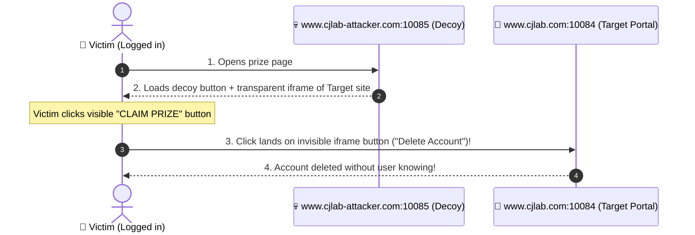

# Lab 04 — Clickjacking Attack Lab

**Implementation Type**: Official SEED source adapted for Docker

Official lab manual: https://seedsecuritylabs.org/Labs_20.04/Web/Web_Clickjacking/
Textbook: Chapter 13 — Clickjacking Attack (*Computer & Internet Security*, 2nd Ed., Prof. Wenliang Du)
Lecture Sync Sitemap: [SEED Lecture & Reference Sitemap](../../docs/lectures-and-references.md#5-lab-04--clickjacking-ui-redress)
CWE Reference: [CWE-1021: Improper Restriction of Rendered UI Layers or Frames](https://cwe.mitre.org/data/definitions/1021.html)

For authorized educational use only.

> **HOST BROWSER ROUTING NOTICE**: Access Target site in host browsers via `http://localhost:10084` (or `http://www.cjlab.com:10084`) and Attacker site via `http://localhost:10085` (or `http://www.cjlab-attacker.com:10085`). Do not use internal container IPs `10.9.0.80` or `10.9.0.81` directly in host browsers.  
> **CONTAINER COMMAND FALLBACKS**: If `bash` is missing: `docker exec -it cjlab-10.9.0.80 sh`. If `ip` is missing: `hostname -i`. If `ss` is missing: `netstat -tlnp`.

---

---

## 📖 The Clickjacking Story: The Transparent Decoy

### Act 1 — The Decoy Prize Page
* The attacker creates a flashy gaming/promotional website hosted at **`http://localhost:10085`** (`www.cjlab-attacker.com:10085`) displaying:
  `"🎉 CONGRATULATIONS! CLICK HERE TO CLAIM YOUR FREE PRIZE! 🎁"`
* The user believes they are clicking a harmless prize button.

### Act 2 — The Hidden Target (UI Redress)
* Stacked directly on top of the prize button is a transparent `<iframe>` (`opacity: 0.0001`, `z-index: 100`) loading the legitimate account management site at **`http://localhost:10084`** (`www.cjlab.com:10084`).
* Underneath the cursor, aligned with pixel precision, is the target site's dangerous action button: `"DELETE MY ACCOUNT"` or `"TRANSFER FUNDS"`.

### Act 3 — The Silent Strike
* When the user clicks the visible prize button, the browser registers the click on the top-most (invisible) iframe layer.
* The dangerous account action executes with the user's active session!



---

## 🧪 Official Lab Tasks Walkthrough

### Task 1 — Basic Clickjacking Attack (Overlay Alignment)
* Align the transparent target iframe over the decoy button using CSS absolute positioning (`top`, `left`, `opacity`, `z-index`).

### Task 2 — Clickjacking with Parameter Passing
* Trick the user into clicking multiple sequential buttons (e.g. typing or clicking confirmation dialogues).

### Task 3 — Frame Busting Limitations
* Analyze legacy JavaScript frame-busting scripts (`if (top !== self) top.location = self.location;`) and observe how HTML5 iframe `sandbox` attributes defeat them.

### Task 4 — Modern Defense: HTTP Response Headers
* Configure Apache/PHP to send anti-framing headers:
  ```http
  X-Frame-Options: DENY
  Content-Security-Policy: frame-ancestors 'self'
  ```
* When these headers are present, modern browsers refuse to render the page inside third-party iframes, completely blocking Clickjacking.

---

## Container Architecture

```
HOST MACHINE
  |
  | Hosts file: www.cjlab.com          -> 127.0.0.1 (or localhost:10084)
  | Hosts file: www.cjlab-attacker.com -> 127.0.0.1 (or localhost:10085)
  |
  | Port 10084 -> cjlab-10.9.0.80:80           (target site)
  | Port 10085 -> cjlab-attacker-10.9.0.81:80  (attacker site)
  |
  Docker Bridge Network: net-10.9.0.0-clickjacking (10.9.0.0/24)
    |
    +---- cjlab-10.9.0.80            (Apache, www.cjlab.com, target portal)
    |
    +---- cjlab-attacker-10.9.0.81   (Apache, www.cjlab-attacker.com, overlay page)
```

---

## Layer 1 — Docker Commands (host terminal)

```bash
cd labs/04-clickjacking
.\start.ps1       # Windows PowerShell
./start.sh        # Linux / WSL2 bash
```

---

## Layer 2 — Linux Commands (inside the container)

```bash
docker exec -it cjlab-10.9.0.80 bash
cd /var/www/html
cat index.html
exit
```

---

## Layer 3 — Security Tasks

```
Target Site:   http://localhost:10084  OR  http://www.cjlab.com:10084
Attacker Site: http://localhost:10085  OR  http://www.cjlab-attacker.com:10085
```

---

## Stop and Reset

```bash
docker compose down
docker compose down -v
```
